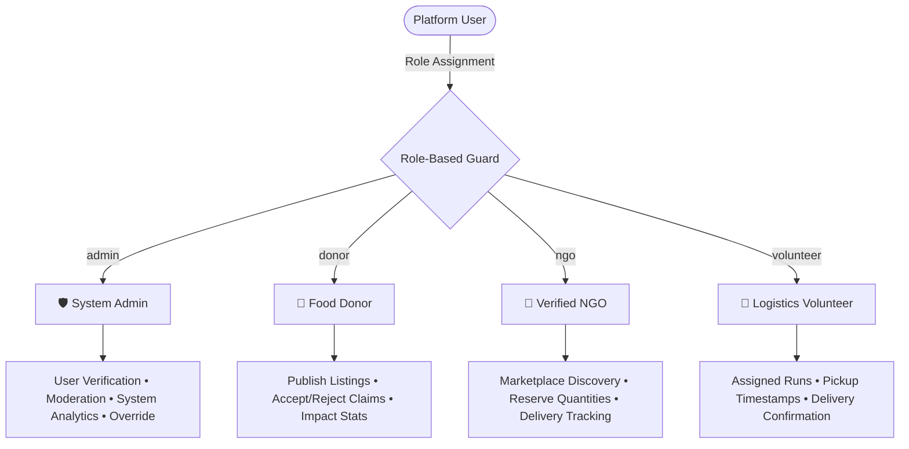
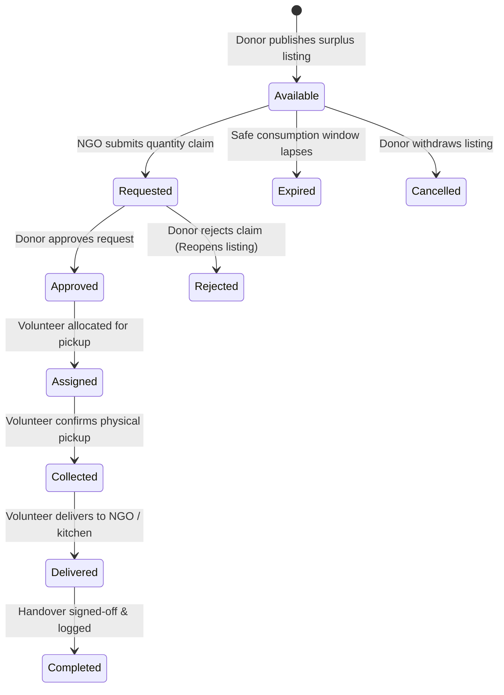

# 🍱 Food Waste Management System (FWMS)
### *Intelligent Redistribution Platform Bridging Food Surplus and Food Insecurity*

[](#)
[](https://nodejs.org/)
[](https://expressjs.com/)
[](https://www.mongodb.com/)
[](https://react.dev/)
[](https://vitejs.dev/)
[](#license)

---

## 📑 Table of Contents

1. [Executive Summary](#-executive-summary)
2. [Key Value Propositions](#-key-value-propositions)
3. [System Architecture](#-system-architecture)
4. [Role-Based Access Control (RBAC)](#-role-based-access-control-rbac)
5. [End-to-End Donation Lifecycle](#-end-to-end-donation-lifecycle)
6. [Localization & Compliance (India-First)](#-localization--compliance-india-first)
7. [Tech Stack Specification](#-tech-stack-specification)
8. [Repository Directory Structure](#-repository-directory-structure)
9. [RESTful API Specification](#-restful-api-specification)
10. [Quickstart & Deployment Guide](#-quickstart--deployment-guide)
11. [Database Seeding & Test Credentials](#-database-seeding--test-credentials)
12. [Security & Concurrency Architecture](#-security--concurrency-architecture)
13. [Troubleshooting & FAQ](#-troubleshooting--faq)
14. [License & Support](#-license--support)

---

## 📌 Executive Summary

The **Food Waste Management System (FWMS)** is a full-stack, enterprise-grade digital logistics and redistribution platform engineered to reduce edible food waste and alleviate hunger. It establishes a real-time, transparent operational pipeline between:

* **Commercial & Domestic Donors** (Restaurants, banquet halls, hotels, caterers, households)
* **Verified Beneficiary Organizations** (NGOs, charitable trusts, orphanages, community kitchens)
* **Logistics & Collection Volunteers** (Local volunteers managing pickup and transport)
* **System Administrators** (Regulators monitoring safety compliance, verification, and platform metrics)

By automating donation publishing, safety validation, algorithmic claim matching, and proof-of-delivery tracking, the system replaces fragmented, ad-hoc food drives with an auditable, scalable redistribution network.

---

## 🎯 Key Value Propositions

| Pillar | Capability | Technical Implementation |
| :--- | :--- | :--- |
| **Waste Mitigation** | Eliminates landfill diversion of edible meals before safety deadlines. | Timestamped `expiresAt` validation and automated inventory status transitions. |
| **Transparency** | Real-time visibility into every phase of collection and delivery. | State machine enforcing atomic handovers with volunteer audit trails. |
| **Safety & Hygiene** | Enforces dietary disclosures and consumption windows. | Mandatory categorization, allergen disclosures, and temperature storage flags. |
| **Zero Over-Claiming** | Eliminates concurrent duplicate claims on scarce quantities. | Atomic database operations decrementing `quantityAvailable` upon donor approval. |
| **Actionable Analytics** | Quantifies environmental and community impact. | MongoDB aggregation pipelines measuring food volume salvaged and trends over time. |

---

## 🏗️ System Architecture

### Architectural Overview

```
┌─────────────────────────────────────────────────────────────────────────┐
│                           PRESENTATION LAYER                            │
│           React 19 SPA • Vite Build System • Component Framework        │
│    Role-Aware Routing • Responsive CSS Design System • REST Fetch API    │
└────────────────────────────────────┬────────────────────────────────────┘
                                     │ JSON / HTTPS (Port 5001)
┌────────────────────────────────────▼────────────────────────────────────┐
│                           APPLICATION LAYER                             │
│                      Node.js & Express.js 4.22 Engine                   │
│                                                                         │
│   ┌─────────────────────┐   ┌────────────────────┐   ┌───────────────┐  │
│   │  Auth & RBAC Guard  │   │  Validation Filter │   │ Rate Limiting │  │
│   │     (JWT/Bcrypt)    │   │ (Express Validator)│   │  & CORS Guard │  │
│   └─────────────────────┘   └────────────────────┘   └───────────────┘  │
│                                                                         │
│   ┌─────────────────────────────────────────────────────────────────┐   │
│   │                 RESTful Controller Handlers                     │   │
│   │  /auth  •  /users  •  /food  •  /donations  •  /requests  ...   │   │
│   └─────────────────────────────────────────────────────────────────┘   │
└────────────────────────────────────┬────────────────────────────────────┘
                                     │ Mongoose ODM v8.x
┌────────────────────────────────────▼────────────────────────────────────┐
│                              DATA LAYER                                 │
│         MongoDB Atlas (Cloud Cluster) / Local MongoDB Server            │
│   Collections: users • fooddonations • foodrequests • collections       │
└─────────────────────────────────────────────────────────────────────────┘
```

---

## 👥 Role-Based Access Control (RBAC)

The system grants fine-grained permissions based on 4 distinct operational roles:



### Role Capability Matrix

| Feature / Action | 🛡️ Admin | 🍲 Donor | 🏢 NGO | 🚚 Volunteer |
| :--- | :---: | :---: | :---: | :---: |
| **Register & Authenticate** | ✅ | ✅ | ✅ | ✅ |
| **Publish Food Donation** | ✅ | ✅ | ❌ | ❌ |
| **Upload Food Imagery & Safety Specs** | ✅ | ✅ | ❌ | ❌ |
| **Browse Active Marketplace** | ✅ | ✅ | ✅ | ✅ |
| **Submit Food Request / Claim** | ✅ | ❌ | ✅ | ❌ |
| **Approve / Reject Requests** | ✅ | ✅ | ❌ | ❌ |
| **Assign Delivery Volunteers** | ✅ | ❌ | ❌ | ❌ |
| **Record Pickup & Delivery Timestamps** | ✅ | ❌ | ❌ | ✅ |
| **Verify / Suspend User Accounts** | ✅ | ❌ | ❌ | ❌ |
| **Inspect System-Wide Analytics** | ✅ | ❌ | ❌ | ❌ |

---

## 🔄 End-to-End Donation Lifecycle

Every donation adheres to a deterministic finite state machine to prevent race conditions, expired consumption, or duplicate reservations:



---

## 🇮🇳 Localization & Compliance (India-First)

FWMS includes built-in localization features tailored for the Indian food ecosystem:

* **Timezone Standard**: All expiry deadlines, prep timestamps, and collection windows are computed in **Asia/Kolkata (IST)**.
* **National Phone Validation**: Regex validation supporting all major Indian telecom prefixes (`^[6-9]\d{9}$`).
* **Postal PIN Code Structure**: Standard 6-digit Indian Postal Index Numbers (`^\d{6}$`).
* **Currency Representation**: Indian Rupee (`₹`) for logistics and cost-per-meal metrics.
* **Pre-Seeded Regional Hubs**: Out-of-the-box support for key metropolitan hubs (Bangalore, Chennai, Mumbai).

---

## 💻 Tech Stack Specification

```
BACKEND STACK
├── Runtime: Node.js (LTS v18+)
├── Framework: Express.js 4.22.3
├── Database: MongoDB (Atlas / Community Edition 7+)
├── ODM: Mongoose 8.24.4
├── Security: JSON Web Tokens (jsonwebtoken 9.0.2) + bcryptjs 2.4.3 (Salt: 12)
├── File Handling: Multer 1.4.5 (Multipart uploads)
└── Validation: Express-Validator 7.2.1

FRONTEND STACK
├── Framework: React 19.2.8
├── Build Tool: Vite 8.3.0
├── Architecture: Component-Driven Modular SPA
├── Networking: Axios & Fetch API with Request Interceptors
└── Styling: Modern Custom CSS (Variables, Flexbox/Grid, Dark-Mode Ready)
```

---

## 📂 Repository Directory Structure

```
Food Waste Management System 02/
├── package.json                    # Workspace root automation scripts
├── README.md                       # Comprehensive system documentation
│
├── Back end/                       # Express & Node.js REST API
│   ├── controllers/                # Business logic controllers
│   │   ├── analyticsController.js  # Metric aggregations & trends
│   │   ├── authController.js       # Register, login, token lifecycle
│   │   ├── collectionController.js # Volunteer dispatch & status tracking
│   │   ├── donationController.js   # Listing creation, queries, image uploads
│   │   ├── notificationController.js # Real-time in-app alerts
│   │   ├── requestController.js    # Claim workflow & state progression
│   │   └── userController.js       # Profile management & admin moderation
│   ├── middleware/
│   │   ├── auth.js                 # JWT verification & RBAC authorization
│   │   └── errorHandler.js         # Centralized error mapping
│   ├── models/                     # Mongoose data schemas
│   │   ├── Collection.js           # Logistics tracking schema
│   │   ├── FoodDonation.js         # Surplus food item schema (20+ attributes)
│   │   ├── FoodRequest.js          # Beneficiary claim schema
│   │   ├── Notification.js         # User alert schema
│   │   └── User.js                 # Account schema with pre-save password hashing
│   ├── routes/                     # Express REST endpoint routers
│   ├── scripts/
│   │   └── seed.js                 # Database seeder with mock data & users
│   ├── uploads/                    # Local storage directory for food images
│   ├── .env                        # Backend environment configuration
│   ├── package.json
│   └── server.js                   # Application bootstrap & entrypoint
│
└── Front end/                      # React 19 Client Application
    ├── public/                     # Static media and favicons
    ├── src/
    │   ├── api/                    # Modular API client definitions
    │   ├── components/             # Reusable UI component library
    │   ├── context/                # React Context (Auth, Notifications)
    │   ├── hooks/                  # Custom React hooks (useAuth, etc.)
    │   ├── pages/                  # Primary screen controllers
    │   ├── utils/                  # Formatters, constants, and validators
    │   ├── App.jsx                 # View state router & layout coordinator
    │   ├── main.jsx                # DOM mounting & React root
    │   └── style.css               # Global application design system
    ├── index.html
    ├── package.json
    └── vite.config.js
```

---

## 📡 RESTful API Specification

Base URL: `http://localhost:5001/api`  
Authentication: Bearer Token via HTTP Header `Authorization: Bearer <JWT>`

### 🔑 Authentication (`/api/auth`)

| Method | Endpoint | Access | Purpose |
| :--- | :--- | :---: | :--- |
| `POST` | `/api/auth/register` | Public | Register a new user (`donor`, `ngo`, `volunteer`) |
| `POST` | `/api/auth/login` | Public | Authenticate credentials and return signed JWT |
| `GET` | `/api/auth/me` | Protected | Return currently authenticated user profile |
| `POST` | `/api/auth/forgot-password` | Public | Issue a cryptographically secure reset token |
| `POST` | `/api/auth/reset-password/:token` | Public | Complete password reset using token |

### 👥 User Administration (`/api/users`)

| Method | Endpoint | Access | Purpose |
| :--- | :--- | :---: | :--- |
| `GET` | `/api/users` | Admin | Retrieve paginated user directory with role filters |
| `GET` | `/api/users/:id` | Protected | Fetch user account details |
| `PUT` | `/api/users/:id` | Protected | Update profile metadata |
| `DELETE` | `/api/users/:id` | Admin | Permanently delete user record |
| `PUT` | `/api/users/:id/verify` | Admin | Toggle verified status for NGOs / Donors |
| `PUT` | `/api/users/:id/suspend` | Admin | Suspend or reactivate account access |
| `PUT` | `/api/users/change-password` | Protected | Rotate password with old password verification |

### 🍱 Surplus Food Donations (`/api/donations` & `/api/food`)

| Method | Endpoint | Access | Purpose |
| :--- | :--- | :---: | :--- |
| `POST` | `/api/donations` | Donor, Admin | Publish a new surplus food listing |
| `GET` | `/api/donations` | Public | Search/filter available food (category, city, veg) |
| `GET` | `/api/food/available`| Public | Fetch active listings (compatible with client card view) |
| `GET` | `/api/donations/my` | Donor | List all donations created by current donor |
| `GET` | `/api/donations/:id` | Public | View donation details (increments view count) |
| `PUT` | `/api/donations/:id` | Owner, Admin | Edit listing details |
| `DELETE` | `/api/donations/:id` | Owner, Admin | Delete listing record |
| `POST` | `/api/donations/:id/image` | Owner, Admin | Upload food photos via Multipart form |

### 📋 Request & Claim Management (`/api/requests`)

| Method | Endpoint | Access | Purpose |
| :--- | :--- | :---: | :--- |
| `POST` | `/api/requests` | NGO, Admin | Submit quantity reservation request |
| `GET` | `/api/requests/all` | Public/Admin | Retrieve all requests for dashboard monitoring |
| `GET` | `/api/requests/my` | NGO | View organization's submitted requests |
| `GET` | `/api/requests/for-donor` | Donor | Inspect incoming claims on donor's listings |
| `PUT` | `/api/requests/:id/approve` | Donor, Admin | Approve request & automatically deduct inventory |
| `PUT` | `/api/requests/:id/reject` | Donor, Admin | Reject claim with optional reason string |
| `PUT` | `/api/requests/:id/cancel` | Requester | Cancel pending claim before donor review |
| `PUT` | `/api/requests/:id/complete` | Admin, Donor | Mark donation cycle as fully concluded |

### 🚚 Logistics & Handover (`/api/collections`)

| Method | Endpoint | Access | Purpose |
| :--- | :--- | :---: | :--- |
| `POST` | `/api/collections/assign` | Admin | Assign a volunteer to an approved request |
| `GET` | `/api/collections/my` | Volunteer | Retrieve assigned pickup runs |
| `PUT` | `/api/collections/:id/pickup` | Volunteer | Mark food as physically collected with timestamp |
| `PUT` | `/api/collections/:id/deliver` | Volunteer | Mark food as delivered to destination |

### 📊 Real-Time Analytics (`/api/analytics`)

| Method | Endpoint | Access | Purpose |
| :--- | :--- | :---: | :--- |
| `GET` | `/api/analytics/overview` | Admin | Macro platform stats (meals saved, user counts) |
| `GET` | `/api/analytics/trends` | Admin | 30-day donation volume timeline |
| `GET` | `/api/analytics/categories` | Public | Categorical distribution of salvaged food items |
| `GET` | `/api/analytics/donor-stats` | Donor | Personal donation volume & fulfillment rates |

---

## 🚀 Quickstart & Deployment Guide

### Prerequisites
* **Node.js**: v18.0.0 or higher
* **npm**: v9.0.0 or higher
* **MongoDB**: A cloud instance on [MongoDB Atlas](https://cloud.mongodb.com/) or local server

> [!NOTE]
> The backend operates on **Port `5001`** by default to eliminate conflicts with macOS AirPlay Receiver (`ControlCenter`), which reserves port 5000 on macOS Monterey through Sequoia.

---

### Step 1: Clone Repository & Configure Environment

```bash
# Clone the project repository
git clone https://github.com/your-username/food-waste-management-system.git
cd "Food Waste Management System 02"
```

Verify or configure `Back end/.env`:
```env
MONGO_URI=mongodb+srv://<username>:<password>@cluster0.xxxxx.mongodb.net/food_waste_management?retryWrites=true&w=majority
JWT_SECRET=fwms_super_secret_jwt_key_2026_india
PORT=5001
CORS_ORIGIN=http://localhost:5173
NODE_ENV=development
```

---

### Step 2: Install Dependencies

```bash
# Install backend dependencies
cd "Back end" && npm install

# Install frontend dependencies
cd "../Front end" && npm install
```

---

### Step 3: Populate Database with Seed Data (Optional)

Run the automated seeder to load test accounts, organizations, and sample listings:
```bash
cd "../Back end"
npm run seed
```

---

### Step 4: Launch Applications

Open two terminal sessions:

#### Terminal 1 — Backend API
```bash
cd "Back end"
npm start
```
*Expected Console Output:*
```
🚀 Server running on http://localhost:5001
✅ MongoDB Connected Successfully
```

#### Terminal 2 — Frontend Application
```bash
cd "Front end"
npm run dev
```
*Expected Console Output:*
```
  VITE v8.3.0  ready in 240 ms

  ➜  Local:   http://localhost:5173/
  ➜  Network: use --host to expose
```

Open your browser at **`http://localhost:5173`**.

---

## 🧪 Database Seeding & Test Credentials

The database seeder provisions verified test accounts across all 4 user roles:

| Role | Display Name | Email Address | Password | Pre-loaded Context |
| :--- | :--- | :--- | :--- | :--- |
| 🛡️ **Admin** | Admin User | `admin@fwms.com` | `Admin@123` | System oversight & verification privileges |
| 🍲 **Donor 1** | Ramesh Kumar | `donor1@fwms.com` | `Donor@123` | Restaurant owner with active Biryani & Bread listings |
| 🍲 **Donor 2** | Priya Sharma | `donor2@fwms.com` | `Donor@123` | Home baker with fruit and pastry listings |
| 🏢 **NGO 1** | Helping Hands NGO | `ngo1@fwms.com` | `NGO@123` | Verified Mumbai NGO (`NGO-MH-2019-001`) |
| 🏢 **NGO 2** | Green Earth NGO | `ngo2@fwms.com` | `NGO@123` | Verified Bangalore NGO (`NGO-KA-2020-045`) |
| 🚚 **Volunteer** | Arjun Volunteer | `volunteer@fwms.com` | `Vol@123` | Active logistics volunteer for transport runs |

---

## 🔒 Security & Concurrency Architecture

1. **Cryptographic Password Hashing**: Passwords undergo pre-save hashing using `bcryptjs` with salt work factor = 12. Plaintext credentials are never saved or returned in API responses.
2. **Stateless JWT Tokens**: Authentication uses digitally signed JSON Web Tokens (7-day validity) transmitted via standard HTTP Authorization headers.
3. **Database Concurrency Protection**: Request approvals decrement `quantityAvailable` atomically, preventing race conditions when multiple NGOs request the same surplus batch.
4. **Resilient Server Boot**: Express starts listening immediately on port 5001 and employs automatic 5-second background retries for database reconnection if the database cluster is momentarily unavailable.
5. **CORS Restrictions**: Explicit origin verification restricts cross-site calls to the authorized frontend domain.
6. **Input Sanitization**: Request payloads undergo structural type checks, regex filtering, and string sanitization.

---

## ❓ Troubleshooting & FAQ

### 1. `EADDRINUSE: address already in use :::5000`
* **Cause**: macOS AirPlay Receiver (`ControlCenter`) listens on port 5000 by default.
* **Resolution**: The platform is pre-configured to use **Port `5001`**. Ensure your `Back end/.env` specifies `PORT=5001`.

### 2. `connect ECONNREFUSED 127.0.0.1:27017`
* **Cause**: Local MongoDB service is inactive.
* **Resolution**: Either start MongoDB locally via `brew services start mongodb-community@7.0` or configure MongoDB Atlas in `Back end/.env`.

### 3. `sh: .../vite: Permission denied`
* **Cause**: Missing execute bit on binary files copied across operating systems.
* **Resolution**: Run `chmod +x "Front end/node_modules/.bin"/*`.

---

## 📄 License & Support

This project is open-source software licensed under the **ISC License**.

*Built to promote responsible food stewardship, minimize waste, and fight hunger.*
# Food-Waste-Management-System
